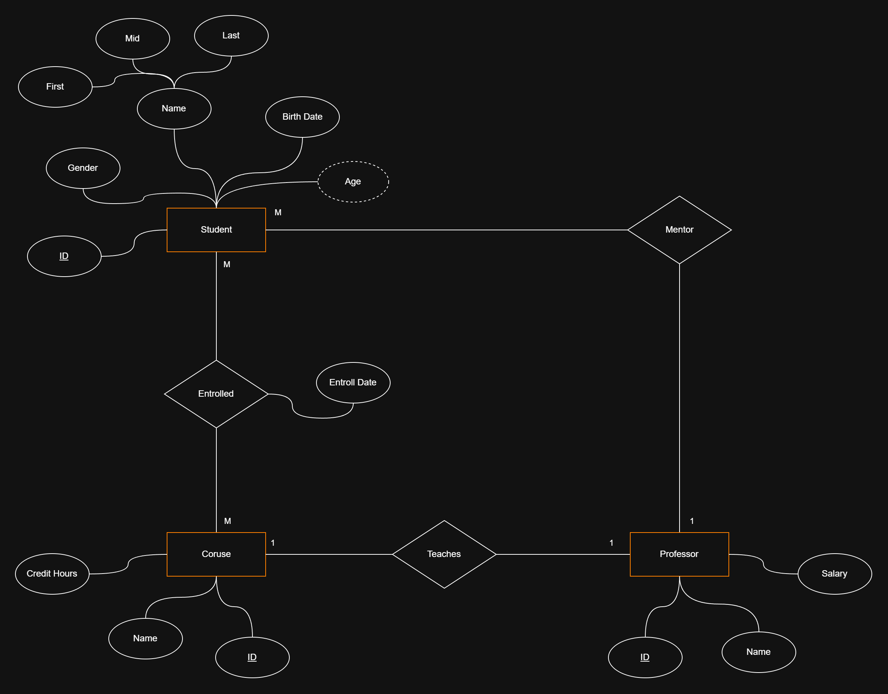

# What Is an ERD, and Why Do We Use It?

## 1. What Is an ERD?

**ERD** stands for **Entity–Relationship Diagram** (also called an **ER Diagram**).

An ERD is a **visual representation of the entities, their attributes, and the relationships between them** in a database design.

It helps us understand and plan the structure of a database **before implementing it**.

An ERD uses specialized symbols to describe a database's conceptual design.

## 2. What Is an ER Model?

**ER Model** stands for **Entity–Relationship Model**.

It is a conceptual approach to describing the data requirements of a system, including the entities, their attributes, and their relationships.

**ER Modeling** is the process of analyzing these requirements and creating a database design before building the actual database.

The **ERD** is the diagram that visually represents this model.

## 3. Three Main Components of an ERD

| Component | Meaning | Example from the lesson |
|---|---|---|
| **Entity** | An object or concept we want to store information about. | `Student`, `Course`, `Professor` |
| **Attribute** | Information that describes an entity (or, in some models, a relationship). | Student `ID`, `Name`, `Birth Date` |
| **Relationship** | An association between entities. | `Student` **Enrolled** in `Course` |

In the ERD notation used in the lesson:

- **Rectangle** → Entity
- **Oval** → Attribute
- **Diamond** → Relationship
- **Underlined attribute** → Key attribute (for example, `ID`)
- **Dashed oval** → Derived attribute (for example, `Age`, derived from `Birth Date`)
- **Oval with smaller connected ovals** → Composite attribute (for example, `Name` split into `First`, `Mid`, and `Last`)

## 4. Example: University ERD

## ERD Example

### Relationships in the Diagram

| Relationship | Connected entities | Labels shown in the diagram | Meaning |
|---|---|---|---|
| **Enrolled** | Student ↔ Course | `M : M` | Many students can enroll in many courses. |
| **Mentor** | Student ↔ Professor | `M : 1` | Multiple students can be mentored by one professor. |
| **Teaches** | Course ↔ Professor | `1 : 1` | The diagram illustrates a one-to-one teaching relationship. |

The **Enrolled** relationship also has an attribute called **Enroll. Date**, which records information about the enrollment relationship.

> **Note:** These cardinalities reproduce the particular example shown in the course slide; they are not universal rules for every university. For instance, a real university might model professor-to-course assignments differently.

## 5. Why Use an ERD?

According to the lesson, an ERD helps us:

1. **Visualize the database** before writing SQL or creating tables.
2. **Identify entities and their attributes** — decide what information the system needs to store.
3. **Understand relationships** among entities.
4. **Reduce design complexity** by organizing requirements clearly.
5. **Communicate the intended structure** to developers and other stakeholders.
6. **Preview the logical organization** of the data before implementation.

## 6. Simple Example

Imagine designing a student registration system.

Before creating tables, ask:

- **Which entities exist?** Students, courses, and professors.
- **What information describes each entity?** IDs, names, dates, and other attributes.
- **How are the entities connected?** Students enroll in courses; professors mentor students and teach courses.

Draw an ERD to record these decisions. Later, you can convert the conceptual design into a **relational schema** and then create the tables in a database system such as SQL Server.

## 7. Quick Summary

| Term | Short definition |
|---|---|
| **ERD / ER Diagram** | Visual diagram of entities, attributes, and relationships. |
| **ER Model** | Conceptual model of data and its relationships. |
| **ER Modeling** | Process of analyzing and designing the data model. |
| **Entity** | Something we want to store data about. |
| **Attribute** | A property that describes an entity or relationship. |
| **Relationship** | An association between entities. |
| **Cardinality** | How many instances of one entity can relate to another. |

**Key idea:** Design the database conceptually with an **ERD** before implementing its tables in SQL Server.

---

*Study notes based on the course slides: “What Is ERD? and Why?”*

