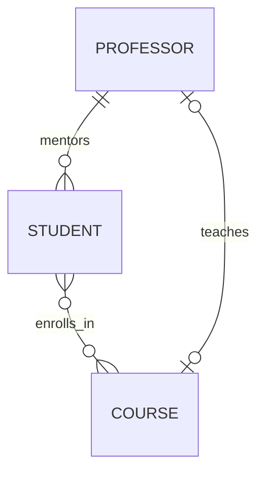

# Steps to Create an Entity–Relationship Diagram (ERD)

> **Course:** Database Design — Conceptual Design  
> **Lesson 10:** Steps to Create an ERD — University Example

## 1. Overview

An **Entity–Relationship Diagram (ERD)** describes the data a system needs, the entities that hold that data, and how those entities are related.

The lesson follows **five steps**:

1. **Entity Identification** — Find the entities mentioned in the requirements.
2. **Relationship Identification** — Find how those entities are connected.
3. **Cardinality Identification** — Determine the minimum and maximum participation in each relationship.
4. **Attribute Identification** — Add the properties of entities and relationships.
5. **Create the ERD** — Combine the results into one diagram and check it against the requirements.

> **Classroom convention for this exercise:** If a requirement does **not** say that a relationship is mandatory, assume its **minimum is 0** (optional). This is a **modeling assumption used for the exercise**, not a universal SQL or database rule. In real projects, ask the stakeholder when a requirement is unclear.

---

## 2. University Case Study — Requirements

The slides give the following requirements:

1. A **Student** enrolls in **Courses**. A student can enroll in more than one course, and each course can have more than one student.
2. Each student has **only one mentor (Professor)**. A professor can mentor more than one student.
3. Each professor can teach **only one course**.
4. Each course can have **only one professor**.
5. A course can have **no professor assigned**.
6. A professor can teach **no courses**.

A useful clarification: **“Only one” sets a maximum of 1, but does not always establish a minimum of 1.** Here, the statement **“Each student has only one mentor”** is treated in the lesson as requiring **exactly one** mentor per student. The teaching relationship explicitly permits zero on both sides.

---

## 3. Step 1 — Entity Identification

**Goal:** Find the main types of things the database must describe.

Look for important nouns in the requirements. In this example, the instructor identifies three entities:

| Entity | Meaning |
|---|---|
| **Student** | A student at the university |
| **Course** | A course offered by the university |
| **Professor** | An academic who may mentor students and teach a course |

In a Chen-style ERD, an **entity type** is drawn as a **rectangle**.

```text
[Student]      [Course]      [Professor]
```

**Tip:** Not every noun is automatically an entity. Some are better modeled as **attributes** (such as `Salary`), while verbs often suggest **relationships**.

---

## 4. Step 2 — Relationship Identification

**Goal:** Find the actions or associations between the entities.

The requirements reveal three relationships:

| Entity 1 | Relationship | Entity 2 | Meaning |
|---|---|---|---|
| Student | **Enrolled** | Course | Students enroll in courses |
| Student | **Mentor** | Professor | A professor mentors students |
| Professor | **Teaches** | Course | Professors teach courses |

In a **Chen ERD**, a relationship is represented by a **diamond** connected to the participating entities.

```text
[Student] --- <Enrolled> --- [Course]
[Student] --- <Mentor>   --- [Professor]
[Professor] -- <Teaches> -- [Course]
```

The **relationship name** should communicate what the two entities do in relation to each other.

---

## 5. Step 3 — Cardinality Identification

For every relationship, ask **two questions in each direction**:

1. **Maximum:** Can one instance connect to **one or many** instances of the other entity?
2. **Minimum:** Can it connect to **zero**, or **must it connect to at least one**?

Write the result as **`(Min, Max)`**.

### A. Student — Enrolled — Course

- **One student → Courses:** Can enroll in **many**; no minimum enrollment is specified, so assume **zero**. Result: **`(0,M)`**.
- **One course → Students:** Can have **many**; no minimum number of students is specified, so assume **zero**. Result: **`(0,M)`**.

**Relationship type:** **Many-to-Many (`M:M`)**, optional on both sides under the exercise's assumption.

### B. Student — Mentor — Professor

- **One student → Professors:** Has **exactly one mentor**. Result: **`(1,1)`**.
- **One professor → Students:** May mentor **many students**; the requirements do not say every professor must mentor at least one, so assume **zero**. Result: **`(0,M)`**.

**Relationship type:** **Many-to-One (`M:1`)** from Student to Professor.

In the lecture diagram, **`(0,M)` is written near Student** and **`(1,1)` near Professor**. Its placement is read as **the number of instances available on that end**: one professor can be connected to zero or many students; one student is connected to exactly one professor.

### C. Professor — Teaches — Course

- **One professor → Courses:** Can teach **at most one course**, but can teach none. Result: **`(0,1)`**.
- **One course → Professors:** Can have **at most one professor**, but can be unassigned. Result: **`(0,1)`**.

**Relationship type:** **One-to-One (`1:1`) maximum cardinality**, optional on both sides.

### Complete relationship summary

| Relationship | One instance on the left can connect to... | One instance on the right can connect to... | Maximum type |
|---|---|---|---|
| Student ↔ Course | Student → **`(0,M)` Courses** | Course → **`(0,M)` Students** | `M:M` |
| Student ↔ Professor | Student → **`(1,1)` Professor** | Professor → **`(0,M)` Students** | `M:1` |
| Professor ↔ Course | Professor → **`(0,1)` Course** | Course → **`(0,1)` Professor** | `1:1` |

> **Notation warning:** The numeric labels in the lecture and the markers in **Crow's Foot** are positioned near the *type being counted*. In some traditional Chen **min–max participation** diagrams, the pair is instead written near the entity *whose participation is being measured*. These conventions can look reversed. Always say what the pair means in plain language before drawing it.

---

## 6. Step 4 — Attribute Identification

**Goal:** Identify each entity's properties and any attributes belonging to a relationship.

### Student attributes

| Attribute | Kind | Notes |
|---|---|---|
| **ID** | Key attribute | Underlined in Chen notation |
| **Name** | Composite | Broken into `First`, `Mid`, and `Last` |
| **Gender** | Simple | Ordinary attribute |
| **BirthDate** | Simple | Used to derive age |
| **Age** | Derived | Dashed ellipse; can be calculated from birth date |
| **Phone** | Multivalued | Double ellipse; a student may have more than one phone number |

### Course attributes

- **ID** — key attribute.
- **Name** — course name.
- **CreditHours** — course credit hours.

### Professor attributes

- **ID** — key attribute.
- **Name** — professor's name.
- **Salary** — salary value.

### Relationship attribute

The **Enrolled** relationship has **EnrollDate** (enrollment date). This date belongs to the **student's enrollment in a particular course**, not necessarily to Student or Course alone.

### Chen attribute symbols — Quick Review

| Shape | Meaning | Example |
|---|---|---|
| Single ellipse | Simple attribute | `Gender` |
| Underlined name inside ellipse | Key attribute | `Student.ID` |
| Ellipse with smaller connected ellipses | Composite attribute | `Name → First, Mid, Last` |
| Double ellipse | Multivalued attribute | `Phone` |
| Dashed ellipse | Derived attribute | `Age` |
| Ellipse attached to relationship diamond | Relationship attribute | `Enrolled.EnrollDate` |

---

## 7. Step 5 — Create and Review the ERD

Bring all four previous steps together:

1. Draw **Student**, **Course**, and **Professor** as entity rectangles.
2. Connect them through **Enrolled**, **Mentor**, and **Teaches** relationship diamonds.
3. Label **minimum and maximum** participation using one consistent notation.
4. Attach each entity's attributes, including keys and special attribute symbols.
5. Attach **EnrollDate** to the **Enrolled** relationship.
6. Review each relationship in **both directions** and check it against the requirements.

### Simplified Crow's Foot overview

GitHub can render this Mermaid diagram. It summarizes the **relationships only**; it is not a full reproduction of the Chen ERD with composite, derived, multivalued, and relationship attributes.



Interpretation:

- Student / Course: zero or many on both ends.
- Professor / Student: one professor per student; zero or many students per professor.
- Professor / Course: zero or one on both ends.

### Final verification checklist

- [ ] Did I identify all three entities?
- [ ] Did I identify all three relationships?
- [ ] Did I check **both directions** of each relationship?
- [ ] Did I distinguish **maximum cardinality** from **minimum participation**?
- [ ] Did I use the instructor's **optional-by-default** assumption only where the requirement is silent?
- [ ] Did I add `Student.ID`, `Course.ID`, and `Professor.ID` as key attributes?
- [ ] Did I represent `Name`, `Age`, and `Phone` using the correct special symbols?
- [ ] Did I attach `EnrollDate` to **Enrolled**?
- [ ] Did I avoid confusing numbers **near** an entity with the number of relationships **that entity itself has**?

---

## 8. Common Mistakes

**Mistake 1 — Assuming that “many” also means “mandatory.”**  
No. **`(0,M)`** and **`(1,M)`** both permit many, but only the second requires at least one.

**Mistake 2 — Assuming a professor must teach a course.**  
The requirements explicitly say a professor can teach **no courses**. So the minimum is **0**.

**Mistake 3 — Assuming every course has a professor.**  
The requirements allow an **unassigned course**. So the minimum is **0**.

**Mistake 4 — Mixing up `Enrolled` with a student attribute.**  
`Enrolled` is the relationship, and `EnrollDate` is an attribute **of that relationship**.

**Mistake 5 — Treating an unstated assumption as a universal fact.**  
For this classroom exercise, an unspecified minimum is modeled as **0**. In a real university system, this could be changed after clarifying its business rules.

---

## 9. Review Questions

Try answering before checking the answers.

1. What are the five steps for creating an ERD?
2. Which three entities are found in the university example?
3. Why is Student–Course a many-to-many relationship?
4. Can a student have zero mentors under the example's requirements?
5. Can a professor teach zero courses?
6. Can a course exist without an assigned professor?
7. What is the difference between `(0,M)` and `(1,M)`?
8. Where should `EnrollDate` be attached in a Chen ERD?
9. How is a multivalued attribute drawn?
10. What is the classroom rule when minimum participation is not mentioned?

<details>
<summary>Suggested answers</summary>

1. Entity identification; relationship identification; cardinality identification; attribute identification; create/review ERD.
2. Student, Course, Professor.
3. A student can take many courses, and a course can have many students.
4. No. The lesson interprets the mentor requirement as exactly one professor per student.
5. Yes; `(0,1)` courses per professor.
6. Yes; `(0,1)` professors per course.
7. Both permit many; `0` makes participation optional while `1` makes it mandatory.
8. To the **Enrolled relationship** diamond.
9. As a **double ellipse**.
10. Assume **optional (minimum 0)** for this exercise, then clarify in real projects.

</details>

---

## 10. Key Terms

| Term | Short definition |
|---|---|
| **Requirement** | A rule describing what the system must support |
| **Entity** | A type of thing represented in the database |
| **Attribute** | A property of an entity or relationship |
| **Relationship** | An association between entities |
| **Cardinality** | The maximum number of connections (`1` or `M`) |
| **Ordinality** | The minimum number of connections (`0` or `1`) in the lesson's terminology |
| **Optional participation** | Minimum `0` |
| **Mandatory participation** | Minimum `1` |
| **Composite attribute** | An attribute with meaningful subparts |
| **Derived attribute** | An attribute calculable from other values |
| **Multivalued attribute** | An attribute that can have several values |
| **Relationship attribute** | A property of a specific relationship instance |

---

### Key Takeaway

**Read the requirements → identify entities → identify relationships → determine minimum and maximum → add attributes → draw and validate the ERD.**

For this lesson, **if mandatory participation is not explicitly stated, assume it is optional (`Min = 0`)**—but remember that this is an **exercise convention**, not a database law.
