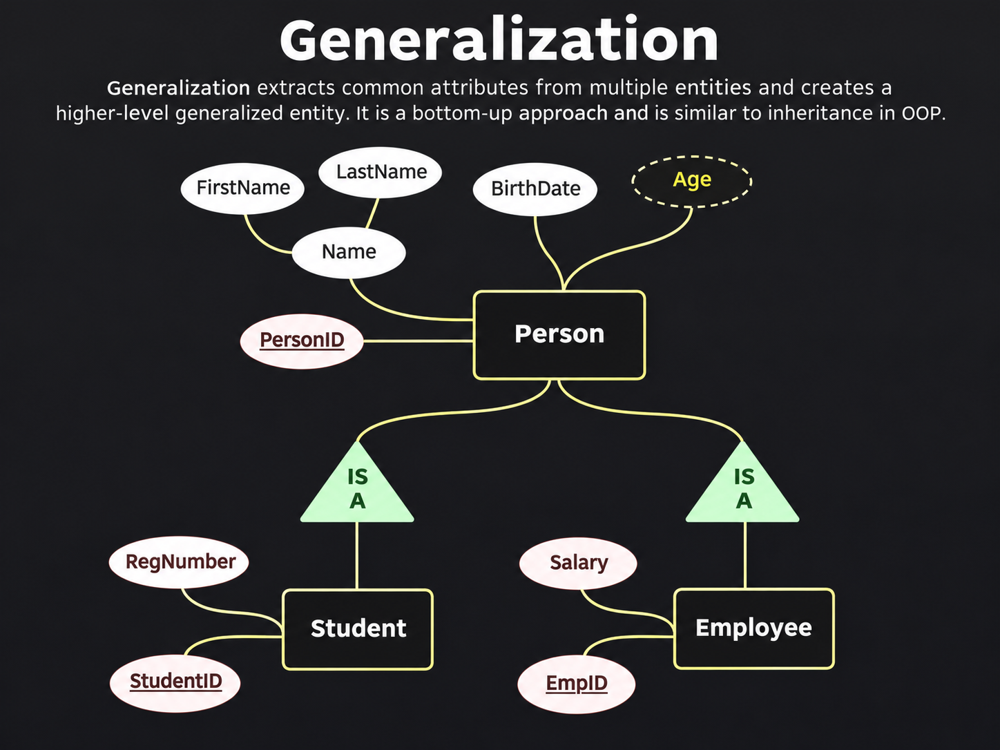

# 12. Generalization in ERD

## What is Generalization?

**Generalization** in ERD is the process of extracting the **common attributes** from two or more entities and moving them into a more general parent entity.

It is a **bottom-up** approach:
- We start with specific entities.
- We notice that they share some common attributes.
- Then we create a **general entity** that holds these shared attributes.

If you already studied **inheritance in OOP**, then generalization will feel very familiar.

---

## Simple Idea

It is very similar to this OOP idea:

- `Student` **is a** `Person`
- `Employee` **is a** `Person`

So instead of repeating the same attributes in both `Student` and `Employee`, we place the common ones in `Person`.

---

## Why do we use Generalization?

We use it to avoid:
- repeating the same attributes many times,
- making the design messy,
- wasting space,
- and making future changes harder.

For example, both **Student** and **Employee** may have:
- FirstName
- LastName
- BirthDate
- Age

So instead of writing these attributes twice, we move them into **Person**.

---

## Example

### General entity:
**Person**
- PersonID
- Name
  - FirstName
  - LastName
- BirthDate
- Age *(derived)*

### Specialized entities:
**Student**
- StudentID
- RegNumber

**Employee**
- EmpID
- Salary

---

## Diagram

---

## How to read the diagram

- `Student` **is a** `Person`
- `Employee` **is a** `Person`
- `Person` contains the common/shared attributes.
- `Student` contains only the attributes that belong specifically to students.
- `Employee` contains only the attributes that belong specifically to employees.

---

## Problem without Generalization

If we do **not** use generalization, then both `Student` and `Employee` will repeat the same attributes like:
- FirstName
- LastName
- BirthDate
- Age

This causes duplication.

Generalization solves this by creating a parent entity: **Person**.

---

## Relation to OOP Inheritance

This is why it feels like inheritance in OOP:

- In **OOP**, a child class inherits from a parent class.
- In **ERD**, a specialized entity comes from a generalized entity.

So yes, your understanding is correct:

> **Generalization in ERD is conceptually very similar to inheritance in OOP.**

But remember:
- In **OOP**, we talk about **classes and inheritance**.
- In **ERD**, we talk about **entities and generalization/specialization**.

---

## Quick Summary

- **Generalization** = extracting common attributes into one general entity.
- It is a **bottom-up** approach.
- It helps reduce duplication.
- It is very similar in idea to **inheritance in OOP**.
- In this example:
  - `Person` is the general entity.
  - `Student` and `Employee` are specialized entities.

---

## File Link Note

This markdown file is connected to the diagram image using this relative link:

`./generalization_erd_person_to_student_and_employee.png`

So if both files stay in the same folder, the image will appear correctly.
