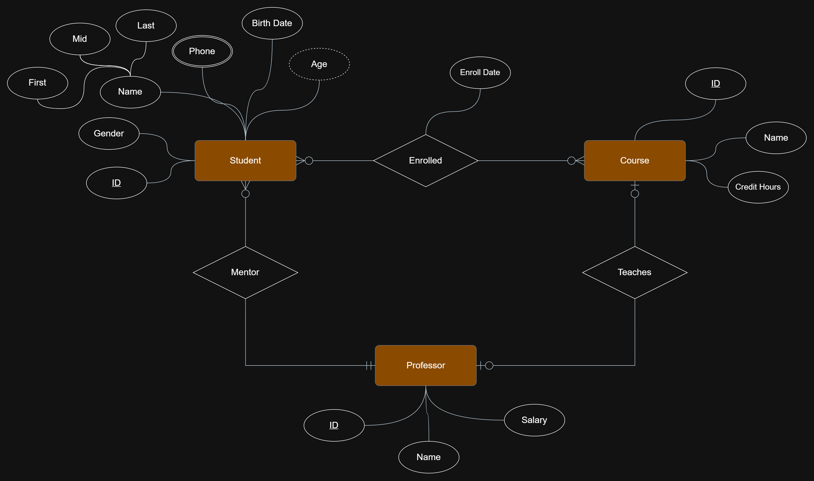

# Library ERD Example

This example illustrates a conceptual **Entity–Relationship Diagram (ERD)**

## ER Diagram

## Diagram Files

- [LibraryERD.png](LibraryERD.png) — diagram preview on GitHub.
- [Library.drawio](Library.drawio) — editable source for [draw.io](https://app.diagrams.net/).
