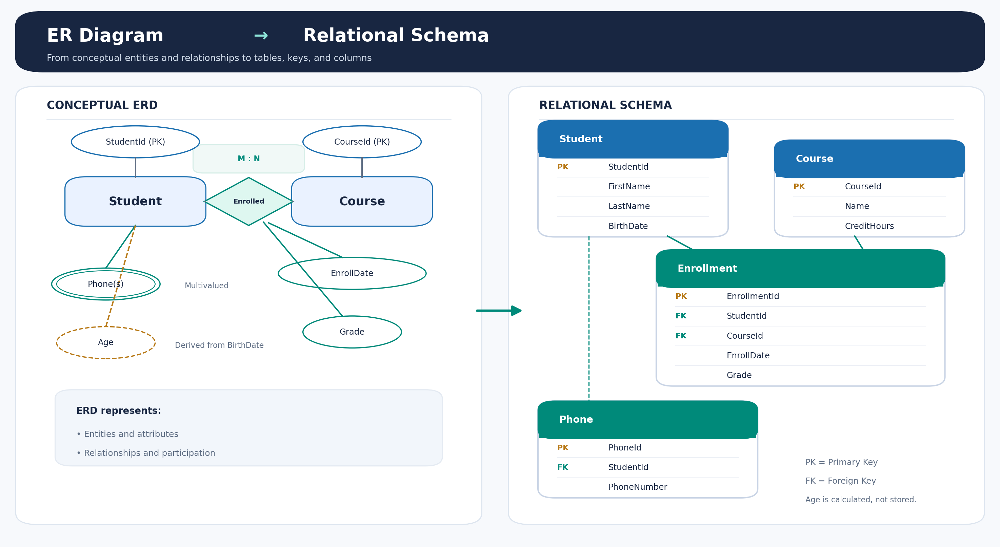

# 01 - What Is a Relational Schema?

## 1. Definition

A **relational schema** describes the **structure of a relational database**: its tables (relations), columns (attributes), data types/domains, keys, and relationships/constraints.

A **relation schema** describes one table. A **database schema** describes how the tables fit together.

> **Schema = database structure**, not the actual rows of data stored in it.

## 2. Main Components

| Term | Meaning | Example |
|---|---|---|
| Relation (Table) | A named collection of rows | `Student` |
| Attribute (Column) | A property of a row | `BirthDate` |
| Domain | The allowed values/type for an attribute | `BirthDate`: valid dates |
| Tuple (Row) | One record in a relation | One particular student |
| Primary Key (PK) | Uniquely identifies each row | `StudentId` |
| Foreign Key (FK) | References a key in another table | `Enrollment.StudentId` |

**Note:** A schema defines the columns and constraints; actual *tuples* are part of the database instance (the stored data).

## 3. Example: ER Diagram to Relational Schema

Suppose an ER diagram includes:

- **Student**: `StudentId`, composite `Name` (`FirstName`, `LastName`), `BirthDate`, derived `Age`, and multivalued `Phone`.
- **Course**: `CourseId`, `Name`, and `CreditHours`.
- **Enrolled**: a many-to-many relationship between `Student` and `Course`, with `EnrollDate` and `Grade`.

The resulting relational schema contains four tables:



### Student

| Column | Role | Example domain |
|---|---|---|
| `StudentId` | PK | Integer |
| `FirstName` | | Text |
| `LastName` | | Text |
| `BirthDate` | | Date |

### Course

| Column | Role | Example domain |
|---|---|---|
| `CourseId` | PK | Integer |
| `Name` | | Text |
| `CreditHours` | | Positive integer |

### Enrollment

| Column | Role | Example domain |
|---|---|---|
| `EnrollmentId` | PK | Integer |
| `StudentId` | FK → `Student.StudentId` | Integer |
| `CourseId` | FK → `Course.CourseId` | Integer |
| `EnrollDate` | | Date |
| `Grade` | | Number or grade code |

### Phone

| Column | Role | Example domain |
|---|---|---|
| `PhoneId` | PK | Integer |
| `StudentId` | FK → `Student.StudentId` | Integer |
| `PhoneNumber` | | Text |

**Design note:** `EnrollmentId` and `PhoneId` are example *surrogate keys*; other key designs are possible. If a student is allowed to enroll in a course only once, enforce uniqueness on (`StudentId`, `CourseId`). If reenrollment is allowed, the key/constraints must reflect that rule.

## 4. What Changes When We Convert the ERD?

1. **Entities → tables:** `Student` and `Course` become tables.
2. **Simple attributes → columns:** e.g. `BirthDate`.
3. **Composite attributes → components:** `Name` becomes `FirstName` and `LastName`.
4. **Derived attributes:** `Age` can be calculated from `BirthDate`, so we usually do not store it as a separate column.
5. **Multivalued attributes → separate table:** multiple phone numbers are stored in `Phone`, linked to `Student` through a foreign key.
6. **Many-to-many relationships → linking table:** `Enrolled` becomes `Enrollment`, containing foreign keys to `Student` and `Course`, plus attributes of the enrollment itself (`EnrollDate`, `Grade`).

## 5. Schema vs. Data

**Schema:**

```text
Student(StudentId PK, FirstName, LastName, BirthDate)
Course(CourseId PK, Name, CreditHours)
Enrollment(EnrollmentId PK, StudentId FK, CourseId FK, EnrollDate, Grade)
Phone(PhoneId PK, StudentId FK, PhoneNumber)
```

**Data:**

```text
Student: (101, "Ali", "Ahmad", 2003-05-15)
Course:  (10, "Databases", 3)
Enrollment: (1, 101, 10, 2026-10-01, 90)
Phone: (1, 101, "05551234567")
```

The **schema** tells us which columns and relationships exist. The **data** fills the tables with actual records.

## 6. Key Takeaways

- An **ERD** is a conceptual model of entities, attributes, and relationships.
- A **relational schema** translates those concepts into tables, columns, keys, and constraints.
- **PK** identifies a row; **FK** connects related tables.
- Each column has a **domain** (its permitted values).
- One ERD can sometimes be mapped into more than one valid relational design, depending on the system requirements.

---

*Diagram: [`01_erd_to_relational_schema.png`](./01_erd_to_relational_schema.png). Keep the PNG next to this Markdown file so GitHub can display it.*
